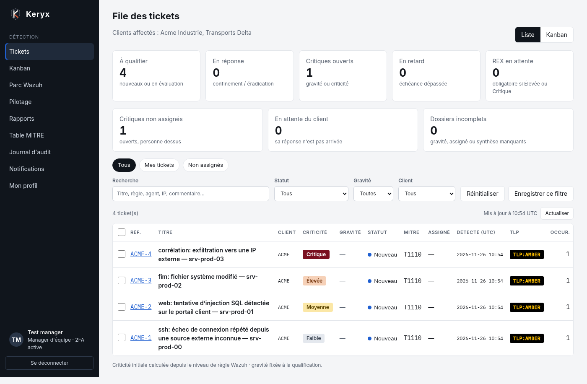
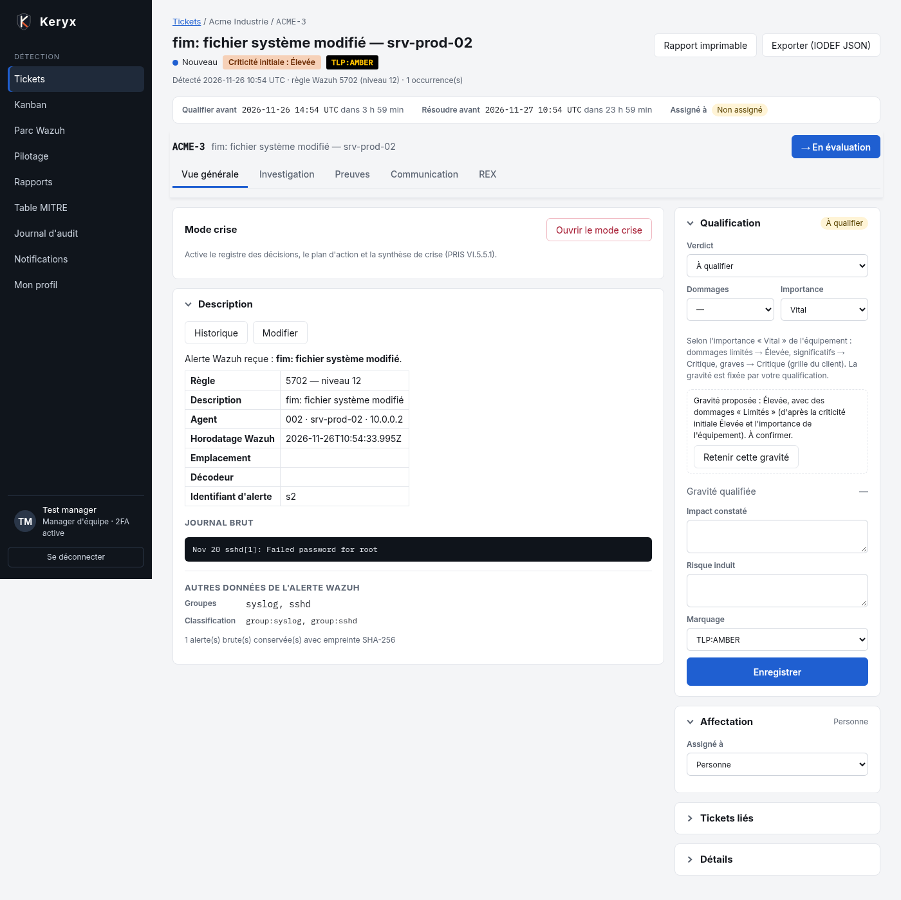
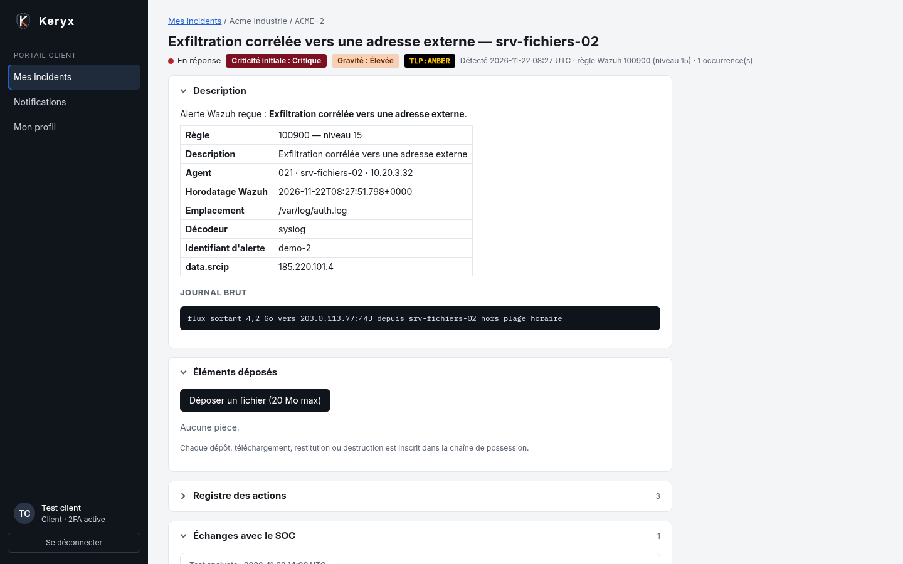
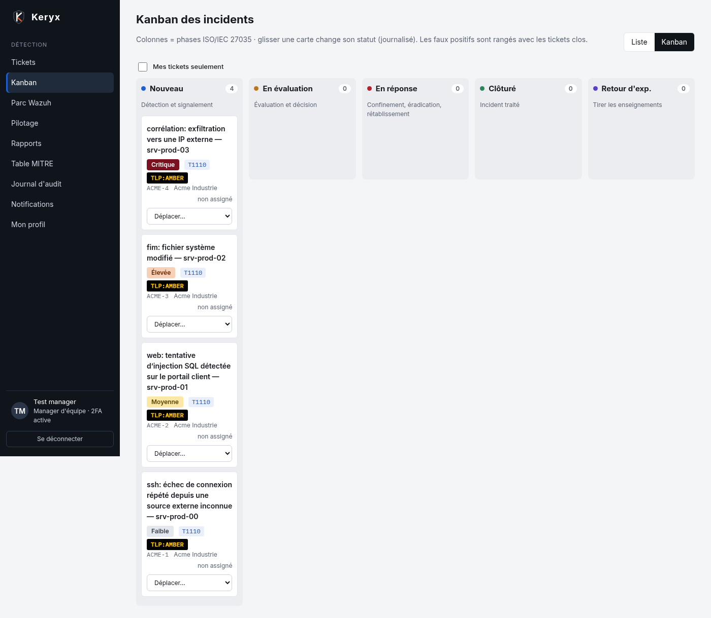
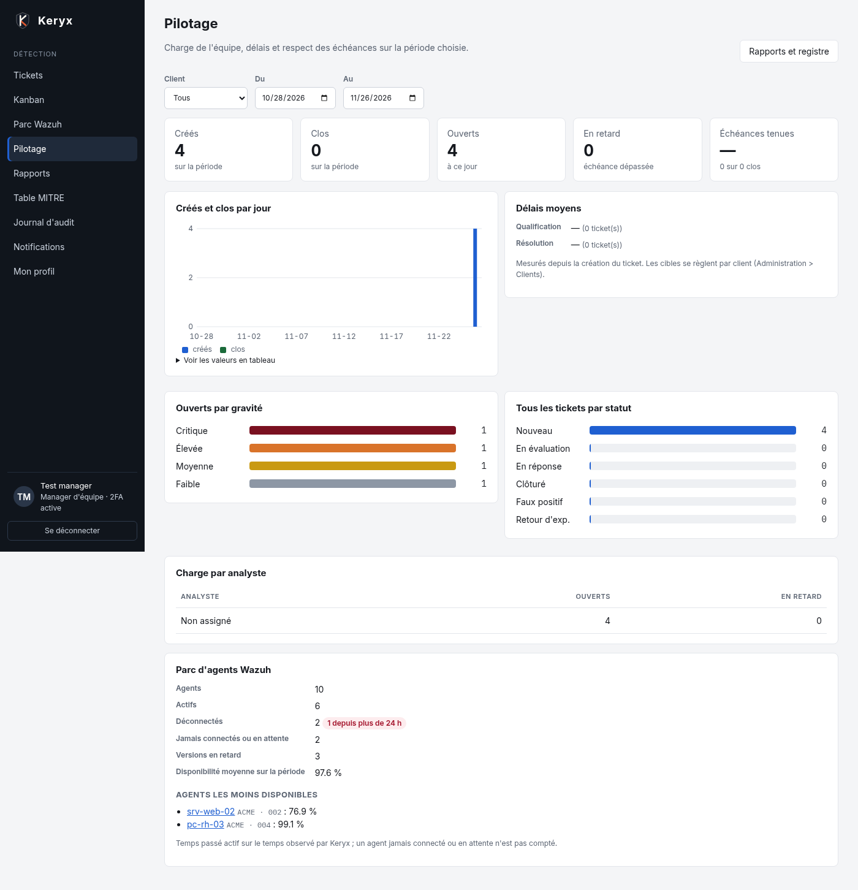
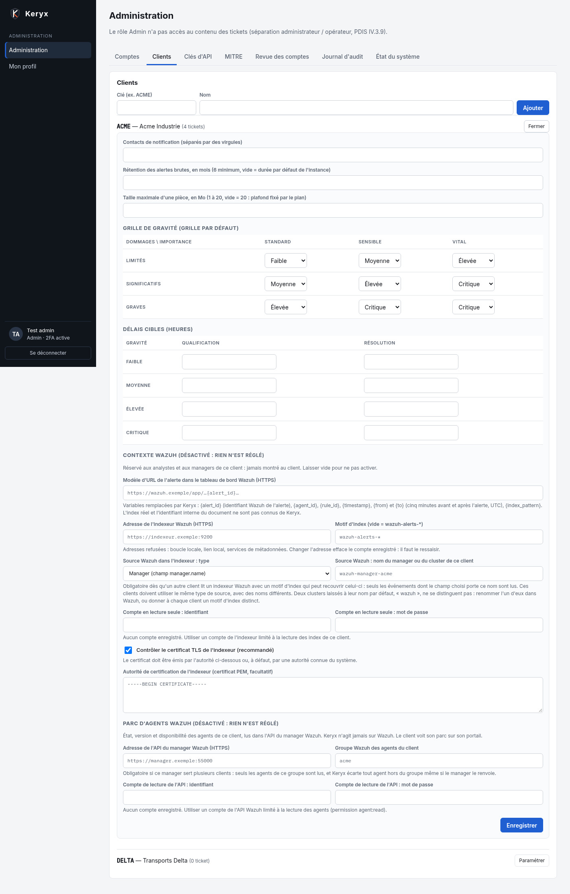

# Keryx

Console de gestion des incidents de sécurité pour un SOC équipé de Wazuh. Une alerte Wazuh arrive, Keryx ouvre un
ticket pré-rempli (règle, équipement, criticité, MITRE ATT&CK), l'équipe le qualifie et le traite, le client suit
son incident sur son portail, et chaque action est inscrite dans un journal d'audit scellé.

Keryx est écrit pour les exigences des référentiels PDIS et PRIS de l'ANSSI et de l'ISO/IEC 27035 : registres,
traçabilité, cloisonnement par client, chaîne de possession des preuves. Un outil ne qualifie pas un prestataire :
la qualification reste une affaire d'organisation.



| Fiche d'un ticket (analyste) | Le même incident vu par le client |
|---|---|
|  |  |

| Kanban | Pilotage | Administration |
|---|---|---|
|  |  |  |

Les captures viennent du banc d'essai : client, équipements et alertes sont fictifs.

## Installer en une commande (Docker)

```bash
git clone https://github.com/Ozer0x777/keryx.git
cd keryx/deploy/docker && ./install.sh
```

Le script demande le nom de domaine, le mode HTTPS (certificat automatique, certificat fourni, ou essai local) et les
profils facultatifs. Il génère les secrets, démarre Keryx, PostgreSQL et le reverse proxy Caddy, crée le premier compte
Admin et affiche le bloc à coller dans Wazuh.

| Profil | Ajoute |
|---|---|
| (socle) | Keryx, PostgreSQL 16, Caddy (HTTPS) |
| `antivirus` | ClamAV : analyse des pièces déposées, quarantaine |
| `sso` | Keycloak : authentification unique, double authentification imposée |
| `objets` | Garage : stockage objet des pièces, chiffré avant envoi |
| `sauvegarde` | Sauvegarde chiffrée planifiée |

**Sauvegardez `deploy/docker/.env`** : il contient la clé maîtresse. Si elle est perdue, les secrets chiffrés et les
sauvegardes le sont aussi. Arrêt sans perte de données : `./uninstall.sh`.

Mode d'emploi : [`deploy/docker/README.md`](deploy/docker/README.md). Durcissement, matrice des flux et limites :
[`docs/deploiement-docker.md`](docs/deploiement-docker.md).

Ce kit tout-en-un convient aux essais, aux démonstrations et à un petit SOC non qualifié. Ce n'est pas une
architecture qualifiable PDIS (une seule machine, pas de zones de confiance). L'architecture cible par zones est
décrite dans la même page.

## Brancher Wazuh

1. Dans Keryx : créer le client, puis une clé d'API pour son manager Wazuh (Administration > Clés d'API).
2. Sur le manager : copier `integrations/wazuh/custom-keryx` et `custom-keryx.py` dans `/var/ossec/integrations/`.
3. Ajouter dans `/var/ossec/etc/ossec.conf`, puis redémarrer le manager :

```xml
<integration>
  <name>custom-keryx</name>
  <hook_url>https://keryx.exemple.eu/api/v1/ingest/wazuh</hook_url>
  <api_key>kx_VOTRE_CLE</api_key>
  <level>7</level>
  <alert_format>json</alert_format>
</integration>
```

Détail, file d'attente locale si Keryx est injoignable : [`integrations/wazuh/README.md`](integrations/wazuh/README.md).

## Ce que fait Keryx

**Traiter**
- Ticket pré-rempli depuis l'alerte, alerte brute conservée avec son empreinte, dédoublonnage sur 15 minutes.
- Cycle de vie ISO/IEC 27035 : nouveau, en évaluation, faux positif ou incident confirmé, en réponse, clôturé, retour
  d'expérience (obligatoire si la gravité est Élevée ou Critique).
- Criticité initiale tirée du niveau Wazuh, gravité qualifiée selon une grille propre à chaque client, échéances.
- MITRE ATT&CK : repris de Wazuh, sinon d'une table de correspondance, sinon complété à la main. Jamais deviné.
- File de triage, Kanban, recherche, filtres enregistrés, affectation en masse, liens et fusion, modèles, mode crise.

**Prouver**
- Pièces jointes avec registre de collecte, empreinte SHA-256, chaîne de possession, quarantaine antivirus.
- Journal d'audit en ajout seul, scellé par HMAC, exportable en syslog, avec point de contrôle externe.
- Horodatage de confiance RFC 3161 des pièces et du journal (facultatif).
- Export IODEF, classification ETSI GS ISI 002, registre par client, rapports imprimables.

**Cloisonner**
- Quatre rôles : Admin (aucun accès au contenu des tickets), Manager, Analyste, Client (ses incidents seulement,
  jamais les notes internes).
- Cloisonnement par client dans la couche d'accès aux données, vérifié par des tests.
- Mot de passe Argon2id et TOTP obligatoire, clés de sécurité WebAuthn, authentification unique OpenID Connect.

**Enrichir** (facultatif)
- Contexte Wazuh : lien vers l'alerte et lecture des événements voisins du même agent dans l'indexeur.
- Recherche d'une empreinte sur VirusTotal avec la clé de l'analyste. Seule l'empreinte sort, jamais un fichier.
  C'est un service externe hors UE : voir l'ADR-0022 avant de l'activer.

Interface en français et en anglais. Aucun service externe n'est appelé par défaut : pas de CDN, pas d'API tierce.

Table complète des fonctions et de leurs exigences : [`docs/fonctions-et-exigences.md`](docs/fonctions-et-exigences.md).

## Documentation

| Sujet | Où |
|---|---|
| Exploitation au quotidien | [`docs/exploitation.md`](docs/exploitation.md) |
| Variables de configuration | [`docs/configuration.md`](docs/configuration.md) |
| Déploiement Docker, fiche ANSSI, PDIS | [`docs/deploiement-docker.md`](docs/deploiement-docker.md) |
| Décisions d'architecture (ADR) | [`docs/adr/`](docs/adr/) |
| Matrice exigence, code, test | [`docs/matrice-tracabilite.md`](docs/matrice-tracabilite.md) |
| Dossier pour l'homologation | [`docs/homologation/`](docs/homologation/) |

## Démarrer en local (SQLite)

```bash
pip install -r requirements-dev.txt
(cd web && npm ci && npm run build)          # interface servie par FastAPI depuis keryx/web_dist

export KERYX_DATABASE_URL=sqlite:///./keryx.db
export KERYX_SECRET_KEY=$(python -m keryx.cli gen-key)   # à conserver : chiffre les secrets TOTP et scelle l'audit
export KERYX_COOKIE_SECURE=false            # uniquement en local sans HTTPS
alembic upgrade head                        # crée / met à jour le schéma

python -m keryx.cli add-client ACME "ACME Industrie"
python -m keryx.cli set-contacts ACME soc@acme.example
python -m keryx.cli add-user sbenali "S. Benali" analyst --clients ACME   # affiche l'URI TOTP et 10 codes de secours
python -m keryx.cli add-api-key ACME wazuh-manager-01
python -m keryx.cli add-mitre --group authentication_failures T1110 "Brute Force" "Credential Access"
uvicorn keryx.api:create_app --factory --port 8000
```

Interface : http://localhost:8000 (connexion mot de passe + TOTP). En développement de l'interface :
`cd web && npm run dev` (port 5173, l'API est relayée vers le port 8000).

Envoyer une alerte de test :

```bash
curl -X POST http://localhost:8000/api/v1/ingest/wazuh \
  -H "Authorization: Bearer kx_..." -H "Content-Type: application/json" \
  -d @exemple-alerte.json
```

Brancher un vrai Wazuh : voir `integrations/wazuh/README.md` (script d'intégration avec file d'attente locale si Keryx est injoignable).

## Tests

```bash
python -m pytest -q
```

395 tests avec des alertes Wazuh simulées : ingestion, cloisonnement par client, workflow, audit,
régressions des revues, migrations, notifications (SMTP simulé, relances), pièces jointes (clamd simulé, EICAR),
administration, confort de travail, pilotage, conformité, sauvegarde, script d'intégration Wazuh,
contexte Wazuh (faux indexeur OpenSearch local, `tests/fake_indexer.py`),
recherche d'empreinte sur VirusTotal (faux serveur local, `tests/fake_virustotal.py` : rien ne part vers le vrai service).

Essais contre de vrais composants (facultatifs) : `KERYX_TEST_S3_REAL='endpoint|bucket|clé|secret|région'` (serveur S3), `KERYX_TEST_TSA_REAL='url|ca.pem'` (autorité d'horodatage), `E2E_KEYCLOAK=http://hôte:8180` (SSO). Dossier pour les tiers : `docs/homologation/`.

Parcours dans un navigateur (Chrome sans tête, base temporaire : parcours de chaque rôle, mise en page à 1400, 1024, 768 et 390 px, couverture de la traduction anglaise, SSO réel, horodatage, ETSI ISI, contrôle d'accessibilité axe-core) :
```bash
cd e2e && npm ci && node run.mjs        # CHROME_PATH et KERYX_PYTHON si besoin
```

## Limites connues

- Limites de débit en mémoire, par processus : un seul processus uvicorn tant qu'elles ne sont pas partagées (ADR-0010).
- Quarantaine : archive ZIP chiffrée (mot de passe « infected ») ; les pièces mises en quarantaine avant cette version restent stockées telles quelles (ADR-0019).
- PostgreSQL 16 : la suite complète passe (393 tests lors de la dernière exécution sous PostgreSQL, antérieure au test de `add-user --activation` ; cette commande a été exercée sous PostgreSQL 16.16 par le déploiement Docker d'essai ; dont migrations aller-retour, ingestion concurrente, sauvegarde pg_dump / pg_restore). Non testé : haute disponibilité, réplication, très gros volumes.
- Ingestion testée contre un vrai manager Wazuh de préproduction (188 alertes envoyées, 188 reçues, aucune perte), en plus du serveur simulé des tests. Le contexte de l'indexeur et le lien vers le tableau de bord n'ont pas été éprouvés (voir ci-dessous).
- Déploiement Docker (ADR-0023) : essayé en mode local avec tous les profils ; le mode ACME, un vrai certificat fourni et les réglages du démon Docker (`userns-remap`, `bridge: none`, export des journaux) ne l'ont pas été. Ce n'est pas le cloisonnement en zones de PDIS IV.3.8.b, et Keryx ne sait pas encore séparer son portail client de sa console d'analyse (PDIS IV.3.13.b).
- Contexte Wazuh (ADR-0021) : jamais testé contre un vrai indexeur ni un vrai tableau de bord Wazuh, seulement contre le faux indexeur des tests. À valider avant usage : champ de date, type du champ `agent.id`, motif d'index, droits du compte de lecture, certificat, modèle d'URL.
- Recherche VirusTotal (ADR-0022) : jamais testée contre le vrai VirusTotal, seulement contre le faux serveur des tests. À valider avant usage : forme des réponses et des erreurs, forme des clés, quotas, conditions d'utilisation de l'API (à vérifier par l'exploitant). Keryx n'envoie aucun fichier à VirusTotal.
- Interface testée dans Chrome sans tête (parcours de chaque rôle) et contrôlée avec axe-core (WCAG 2.1 A/AA) ; pas d'audit RGAA complet ni de test d'intrusion.
- Restent en français par construction, même en mode anglais : le corps de ticket généré par le serveur à partir de l'alerte Wazuh (libellés « Règle », « Décodeur »…), les lignes techniques du registre des actions (codes d'action et clés de détail) et les noms de langues.
- Pas encore : validation IODEF contre le schéma officiel complet, PDF généré côté serveur (impression du navigateur à la place).

## Licence

MIT. Voir [`LICENSE`](LICENSE).
